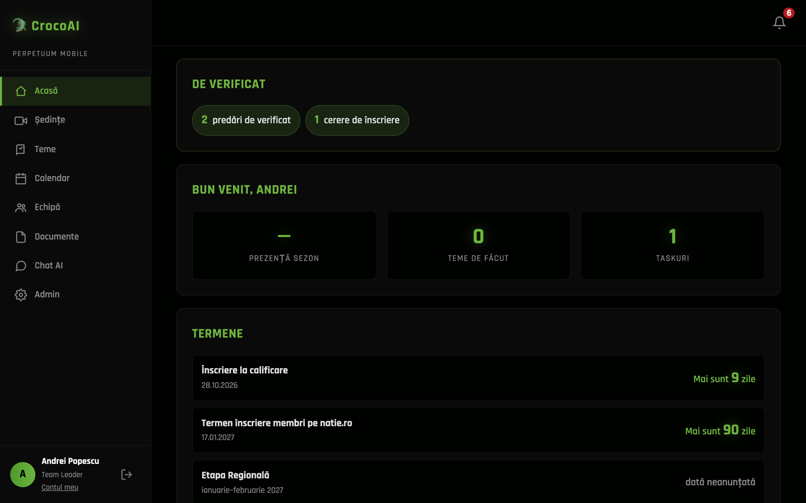
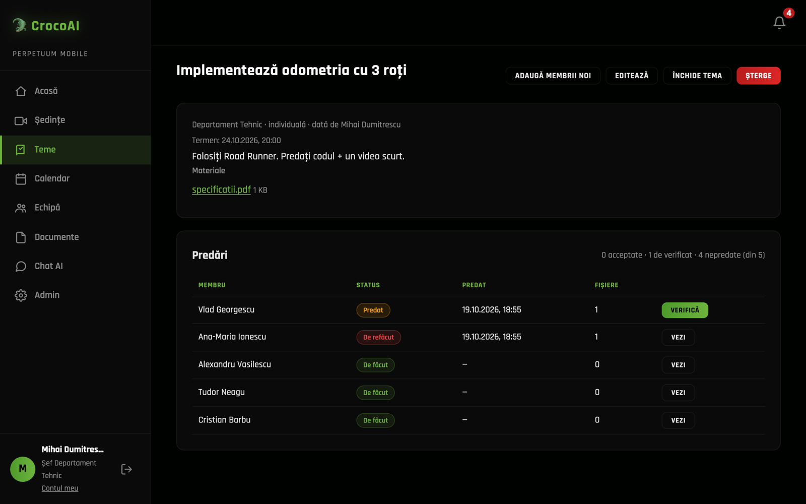
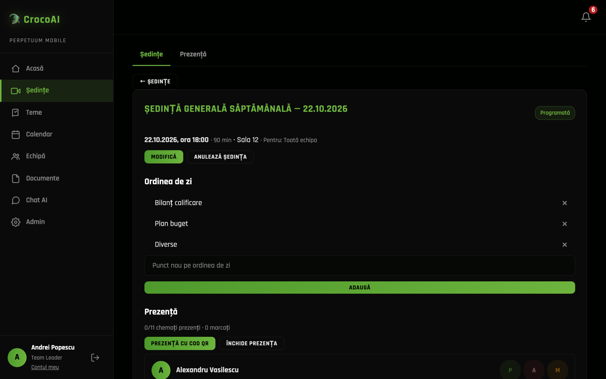
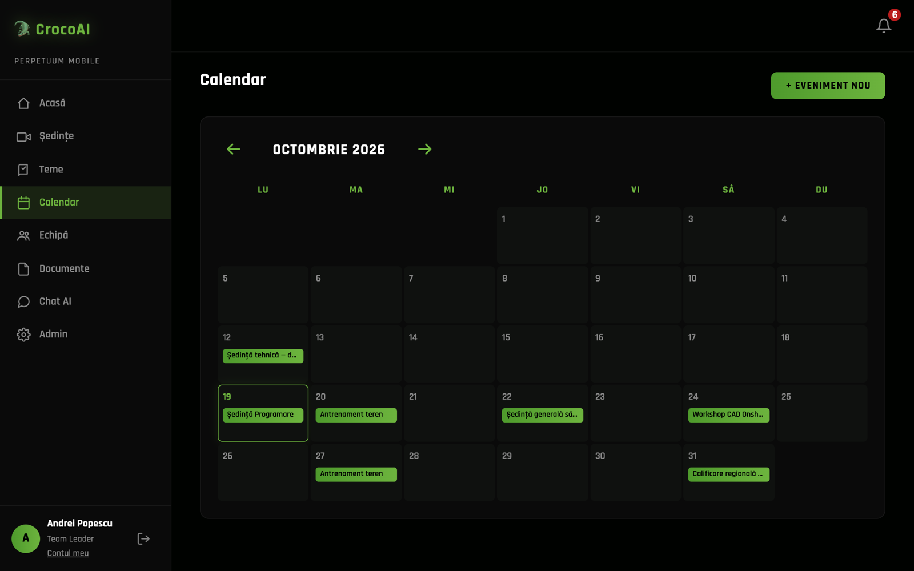
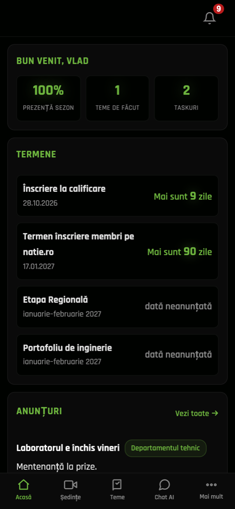
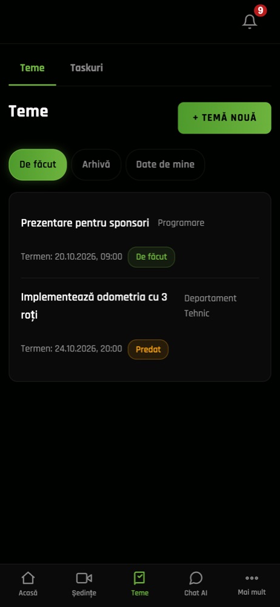
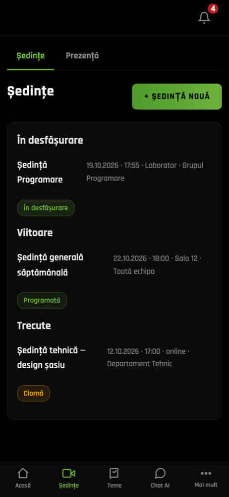
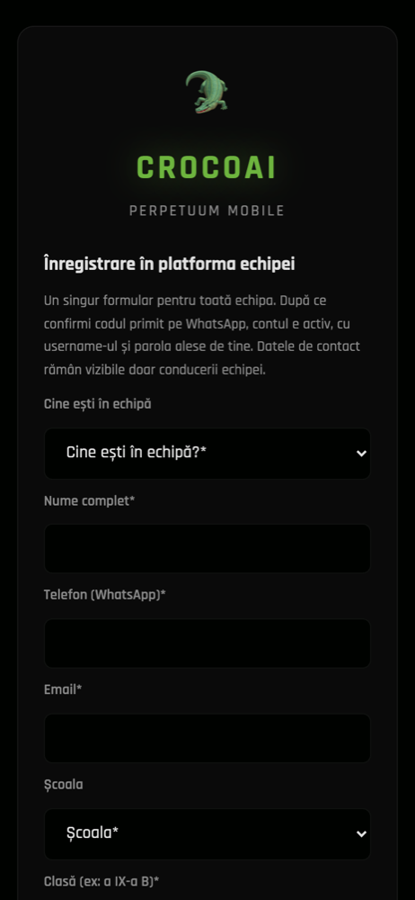

# CrocoAI 🐊

**The team platform and WhatsApp AI assistant of a FIRST® Tech Challenge team.**

Built by and for [Perpetuum Mobile](https://perpetuummobile.tech), FTC #17870, Romania. It runs the team's
day-to-day work: members and roles, meetings and attendance, assignments, tasks, documents and announcements.
An AI assistant, "the crocodile", answers on WhatsApp and in the web app.

> 🇷🇴 **Pe scurt:** CrocoAI este platforma internă a echipei Perpetuum Mobile. Include membri și roluri, ședințe cu
> prezență prin cod QR și înregistrare audio, procese-verbale generate de AI, teme pe departamente și grupuri,
> taskuri cu remindere pe WhatsApp, documente GDPR și un asistent AI care răspunde din regulamentul echipei și din
> manualul FTC. Interfața e în română. Platforma funcționează și fără AI (vezi
> [Fără AI](#using-it-without-ai)).

| Home (team leader) | Assignment review (head of department) |
|---|---|
|  |  |

| Meeting page | Calendar |
|---|---|
|  |  |

| Phone: home | Phone: assignments | Phone: meetings | Phone: registration |
|---|---|---|---|
|  |  |  |  |

*The screenshots use demo data; all names are made up.*

---

## Contents

- [Features](#features)
- [Roles](#roles)
- [How the team uses it](#how-the-team-uses-it), with walkthroughs and examples
- [The AI assistant](#the-ai-assistant): what it is built on, what it can do, its safety limits and costs
- [Using it without AI](#using-it-without-ai)
- [Quick start](#quick-start) and [production install](docs/instalare.md)
- [Configuration](#configuration)
- [Architecture](#architecture)
- [Adapting it for your team](#adapting-it-for-your-team)
- [Development](#development)
- [License](#license)

---

## Features

| Area | What it does |
|---|---|
| **Home** | Countdown to competition deadlines, announcements, your assignments, your to-dos, your next meetings, your attendance. Leaders also get a "De verificat" row: submissions to review, registration requests and absence excuses. |
| **Members** | Profiles, roles, departments (technical / non-technical / both), statuses (active, paused, left, alumni), groups of members. |
| **Self-registration** | A public form (`/inscriere`). The phone number is verified with a 6-digit code sent on WhatsApp. Leaders approve the requested role. |
| **Meetings** (*Ședințe*) | Scheduling, including weekly series, with an agenda. Attendance by QR code: the organiser shows a code that changes every 30 s and members scan it with their phones. The meeting can be recorded live in the browser, or a recording uploaded afterwards. The recording is transcribed into draft minutes (*proces-verbal*), which are approved and exported. Each meeting has an audience: the whole team, a department or a group. |
| **Attendance** | Per-member statistics, absence excuses (*motivări*) with approval, export. |
| **Assignments** (*Teme*) | Given to a department or a group (individual or team work), with materials, a to-do checklist and a deadline. Members submit files and text. Leaders accept the work or send it back for changes. Heads of department manage everything in their department. |
| **Tasks and reminders** | Personal or assigned tasks with an optional "remind me at" time, delivered in the app and on WhatsApp. |
| **Calendar** | Team events (meetings, training, competitions, events) with weekly series and Google Meet links. |
| **Announcements** | For the whole team or for a department, optionally also posted to the team's WhatsApp group. |
| **Documents** | GDPR consents and participation forms with an approval matrix, document templates, and data retention rules. A medical sheet is destroyed automatically when its owner leaves the team. |
| **Photos and resources** | Team photo albums with consent checks, and a shared library of files and links. |
| **Rules** | The team's internal rules, the FTC Romania rules and the FTC Competition Manual, all searchable. The manual is checked monthly for a new version. |
| **PWA** | Installable on phones, works offline (shows an offline page), safe-area aware, built for small screens. |

## Roles

| Role | In short |
|---|---|
| **Team Leader** | Everything, including privileged accounts (co-leader, mentors) and the data access log. |
| **Co-Leader** | Runs the team with the Team Leader (members, meetings, assignments, announcements). |
| **Head of department** (technical / non-technical) | Can do for their department and its groups everything the Team Leader can. In mixed groups, both heads see the work. |
| **Mentor** | Oversight: sees and reviews, but has no student duties (no attendance quota, no student documents). |
| **Member / Volunteer** | Their own assignments, tasks, attendance, documents and profile. A group leader can also give assignments to their group and schedule its meetings. |
| **Alumni** | Read-only access to the team's knowledge. |

Every permission lives in one file, [`app/src/domain/policy.js`](app/src/domain/policy.js). A test,
`test/policy-matrix.test.js`, holds the full action × role × status table and fails when a new action has no row.
The UI never checks roles. It asks the server what the user may do (`GET /api/auth/me` → `permissions`).

## How the team uses it

### A weekly meeting, start to finish

1. **Schedule it.** In *Ședințe* → *Ședință nouă*, a head of department picks a date, time, place or Google Meet, and
   the audience (e.g. *Departament Tehnic*), then adds agenda items. Everyone in the audience gets a notification
   and a WhatsApp reminder.
2. **Take attendance.** At the meeting the organiser presses **Prezență cu cod QR**. Members scan the QR with their
   phones and are marked present. People from other departments can join too and are recorded as extras. The
   organiser can still mark anyone P / A / M (present / absent / excused) by hand.
3. **Record it.** **Înregistrează** records the room audio in the browser in small chunks, so a dropped connection
   loses nothing. You can also upload a recording made with a phone.
4. **Minutes.** After the meeting, **Generează ciorna** transcribes the audio (Groq Whisper) and asks the AI for draft
   minutes: attendance, decisions, tasks with owners. The organiser edits and approves them, and they can be exported
   or printed.
5. **Follow up.** Members ask the assistant on WhatsApp: *„ce s-a decis la ședința de azi?”* ("what was decided at
   today's meeting?").

### An assignment for the non-technical department

1. The head of non-technical creates **Temă nouă**: *„Idee de activitate”*, audience *Departament Non-Tehnic*,
   deadline in a week, a template file attached and a checklist ("pick a date", "fill in the form").
2. Members see it on their home page, tick off the checklist and upload their filled-in form.
3. Home shows the head **„3 predări de verificat”**. They open each submission and either **Acceptă** it or send it
   back with **De refăcut** and a comment. The member is notified either way.

### A new member joins

1. A leader shares `https://<your-domain>/inscriere`.
2. The student fills in their name, class, school, username, password and phone, and picks *recrut nou*,
   *membru vechi*, *șef de departament*, *mentor*…
3. They receive a WhatsApp code, type it in, and are logged in. A requested role other than plain member waits for
   approval in **Echipă → Cereri**.

### Talking to the bot on WhatsApp

```text
Member:  taskuri
Croco:   Taskurile tale deschise:
         1. Postare Instagram despre meciul de calificare — termen 24.10
         2. Fișa de activitate — termen 26.10 🔔

Member:  amintește-mi mâine la 17 să încarc fișa medicală
Croco:   Gata, ți-am pus un reminder pentru 20.10, ora 17:00: „Încarcă fișa medicală”. 🐊

Member:  câte absențe pot avea până primesc avertisment?
Croco:   Conform Art. 20.1 din Regulamentul intern, prezența minimă este … (cites the article)

Member:  what's the max robot size at inspection?
Croco:   According to the Competition Manual, … (searches the current FTC manual and cites the section)
```

In a team WhatsApp group, the bot answers only when it is mentioned or when someone replies to it. In a group it
only uses public knowledge (rules, the manual, events, resources). For anything personal it answers
*„Scrie-mi în privat pentru asta.”* ("Message me privately for that").

## The AI assistant

### What it is built on

- **[Claude Agent SDK](https://docs.anthropic.com/en/docs/claude-code/sdk)** with **Claude Sonnet** (configurable
  with `AI_MODEL`). The agent runs in-process with ~30 tools registered as an in-process MCP server. It is
  isolated: a fixed empty HOME, no host plugins or MCP servers, no session persistence.
- **The same services as the web app.** Every tool calls the same `app/src/services/*` function as the
  matching HTTP route, as the logged-in member, so the bot can never do more than that member could in the UI.
  `test/f2-ai-parity.test.js` fails if a tool has no matching route.
- **A fallback chain.** If a provider fails, the next one is tried:
  **Claude (main) → Claude (backup token) → any OpenAI-compatible model (e.g. self-hosted Qwen) → Groq.** A failing
  provider is skipped for a cooldown. There is no failover after a tool has already written something, so nothing
  is done twice.
- **Groq Whisper** (`whisper-large-v3`) transcribes meeting audio. The audio is first split with ffmpeg into
  10-minute segments.

### What it can do

Some of the tools:

| Tool | Example request |
|---|---|
| `cauta_regulament`, `cauta_manual_ftc` | "What does the rulebook say about the drive team?" |
| `evenimente_urmatoare`, `anunturi_recente` | "When is the next meeting?" |
| `taskurile_mele`, `creeaza_task`, `creeaza_reminder` | "Remind me Friday at 18:00 to charge the batteries" |
| `temele_mele`, `detalii_tema`, `status_predari_tema` | "What do I still have to hand in?" / (leader) "Who hasn't submitted the activity idea?" |
| `prezenta`, `cere_motivare_absenta`, `decide_motivare` | "Excuse my absence on Tuesday, I had an olympiad" |
| `ultimul_proces_verbal`, `deciziile_sedintei`, `cauta_procese_verbale` | "What did we decide about the budget?" |
| `documentele_mele`, `documente_lipsa_echipa` | "Which forms am I missing?" |
| `cauta_resurse` | "Do we have the CAD tutorial?" |
| `trimite_whatsapp` (leaders) | "Tell Vlad the lab is closed tomorrow". The message is not sent until the leader replies **DA** (yes) within 10 minutes. |

It also writes the meeting minutes draft, and summarises what changed when FIRST publishes a new version of the
Competition Manual. The summary is posted as an announcement.

### Safety and limits

- **Scope.** The assistant only talks about the team, FTC and robotics. The model tags off-topic requests
  (`[REFUZ:…]`), and the server replaces the whole answer with a fixed text, so a jailbreak can't leak a creative
  answer. A crisis tag (`[CRIZA]`) gives a fixed message with help resources and alerts the Team Leader and the
  mentors. Only the category is logged, never the content.
- **Limits** (`app/src/domain/ai-policy.js`, overridable from `.env`):
  - 1500 characters per message;
  - 5 messages per minute;
  - a daily quota per member (3× for leaders);
  - a global daily token budget;
  - a daily cost alert to the Team Leader.
- **Privacy.** In groups the bot refuses all personal data. Ex-members and strangers can't use it. Write
  actions on behalf of others need explicit confirmation.

**Measured cost** with Claude Sonnet:

| Request | Cost |
|---|---|
| Deterministic command | $0 |
| Fixed refusal | ≈ $0.008 |
| A question with a search in the manual or the rules | ≈ $0.015–0.06 |
| Meeting minutes draft | a few cents |

## Using it without AI

AI is optional. With no AI key set, CrocoAI is a complete team platform.

| Feature | Without AI |
|---|---|
| Members, registration, roles, groups | ✅ fully |
| Meetings, QR attendance, recording, minutes | ✅. Write the minutes by hand in the editor. With only `GROQ_API_KEY` you still get the transcript. |
| Assignments, tasks, reminders, calendar, announcements, documents, photos | ✅ fully |
| Searching the rules and the FTC manual | ✅ in the web app (*Documente → Regulament / Manuale FTC*) |
| FTC manual updates | ✅ detected monthly. The announcement lists the changed rules without an AI summary. |
| WhatsApp bot, deterministic commands | ✅ `taskuri`, `sedinta` / `evenimente`, `prezenta`, `documente`, `date` / `profil`, `ajutor` |
| WhatsApp bot, free-text questions | ❌. It replies that the assistant isn't configured and lists the commands. |
| Web "Chat AI" page | ❌ (same message) |

Without a WhatsApp gateway, all notifications stay in the app (bell icon), and self-registration is disabled,
because it needs the WhatsApp code. In that case leaders create the accounts and the app shows a one-time password.

## Quick start

Requirements: Node.js 22, plus ffmpeg and poppler-utils if you want transcription and manual updates.

```bash
git clone https://github.com/Perpetuum-Mobile-FTC/CrocoAI.git
cd CrocoAI/app
cp .env.example .env     # set at least JWT_SECRET and ADMIN_INITIAL_PASSWORD
npm install
npm start                # → http://localhost:3001
```

Log in as `admin` (or `ADMIN_USERNAME`) with `ADMIN_INITIAL_PASSWORD`. You'll be asked to choose a new password.
Then:

1. **Echipă → + Membru nou**: add a few members, or import a CSV / vCard.
2. **Admin → Termene**: set your competition deadlines.
3. **Ședințe → Ședință nouă**: schedule a meeting, open it and try **Prezență cu cod QR** from your phone.

For a production setup (Docker, HTTPS, WhatsApp gateway, backups), see **[docs/instalare.md](docs/instalare.md)**.

## Configuration

Everything is set through `app/.env`. [`.env.example`](app/.env.example) documents every variable.

| Variable | Needed for |
|---|---|
| `JWT_SECRET`, `ADMIN_INITIAL_PASSWORD`, `ADMIN_USERNAME` / `ADMIN_FULL_NAME` / `ADMIN_PHONE` | always |
| `APP_BASE_URL` | links in WhatsApp messages |
| `WA_GATEWAY_URL`, `WA_SHARED_SECRET`, `TEAM_GROUP_ID`, `OWNER_PHONE` | WhatsApp ([gateway contract](docs/instalare.md#4-whatsapp-gateway)) |
| `ANTHROPIC_API_KEY` (or `CLAUDE_CODE_OAUTH_TOKEN`), `AI_MODEL` | the AI assistant |
| `CLAUDE_CODE_OAUTH_TOKEN_BACKUP`, `QWEN_*`, `GROQ_API_KEY` + `GROQ_CHAT_MODEL` | AI fallbacks |
| `GROQ_API_KEY` | meeting transcription |
| `GOOGLE_CLIENT_ID` / `_SECRET` / `GOOGLE_TEAM_REFRESH_TOKEN` | automatic Google Meet links |
| `AI_DAILY_LIMIT_MEMBER`, `AI_DAILY_TOKEN_BUDGET`, `AI_DAILY_COST_ALERT_USD`, … | AI limits |

## Architecture

```
app/
├── server.js                 Express app, security headers (CSP without inline scripts), SPA routes
├── src/
│   ├── domain/               pure rules, no database
│   │   ├── policy.js         every permission (action × role × status)
│   │   ├── rules.js          thresholds, deadlines, retention, each citing an article of the team rules
│   │   ├── ai-policy.js      AI scope, refusal / crisis texts, limits
│   │   └── team.js           team name, number, schools, URL: the file another team edits
│   ├── services/             all business logic; called by routes AND AI tools, as the acting member
│   ├── routes/               thin HTTP wrappers (no SQL)
│   ├── ai/                   agent, tools, fallback chain, deterministic commands, confirmations
│   └── db/                   SQLite + numbered migrations (automatic backup before each one)
├── public/                   vanilla ES-module SPA, no build step, PWA (service worker, manifest)
├── knowledge/                team rules, FTC documents (searchable by the app and the AI)
└── test/                     node:test, ~800 tests
```

The golden rule: **routes and AI tools have no logic of their own.** Both call the same service, so the web app
and the bot always agree. Permissions are defined only in `policy.js`, rules only in `rules.js`, and AI behaviour
only in `ai-policy.js`. Design documents, in Romanian, are in [`docs/`](docs/).

Stack: Node.js 22 · Express 5 · SQLite (better-sqlite3) · Claude Agent SDK · Docker · `node:test`.

## Adapting it for your team

1. **`app/src/domain/team.js`:** team name, FTC number, schools offered at registration, school email domain,
   public URL.
2. **`app/knowledge/regulament-intern.md` and `anexe.md`:** your own team rules. `rules.js` cites articles from
   them (e.g. `Art. 20.1` for minimum attendance). Adjust the numbers and thresholds there.
3. **Departments:** `tehnic`, `non-tehnic`, `ambele`, defined in `app/src/domain/audience.js`.
4. **Branding:** the icons in `app/public/` and the colours in `app/public/css/style.css`.
5. **Language:** the UI and the bot are in Romanian. Translating means editing the page modules in
   `app/public/js/pages/` and the texts in `ai-policy.js` / `format.js`.

The FIRST® and Nație Prin Educație documents in `app/knowledge/ftc/` and `app/templates/` belong to their owners
(see [NOTICE.md](NOTICE.md)).

## Development

```bash
cd app
npm test                 # ~800 tests, ~30 s; the AI is always mocked, no network calls
```

See [CONTRIBUTING.md](CONTRIBUTING.md). Please report security issues privately, as described in
[SECURITY.md](SECURITY.md): the platform stores data about minors.

## License

[GNU AGPL-3.0](LICENSE). You may use, modify and host CrocoAI. If you run a modified version for other people,
you must publish your changes under the same license.

Made with 🐊 by Perpetuum Mobile. FIRST® and FIRST® Tech Challenge are trademarks of FIRST®. This project is not
affiliated with FIRST®.
